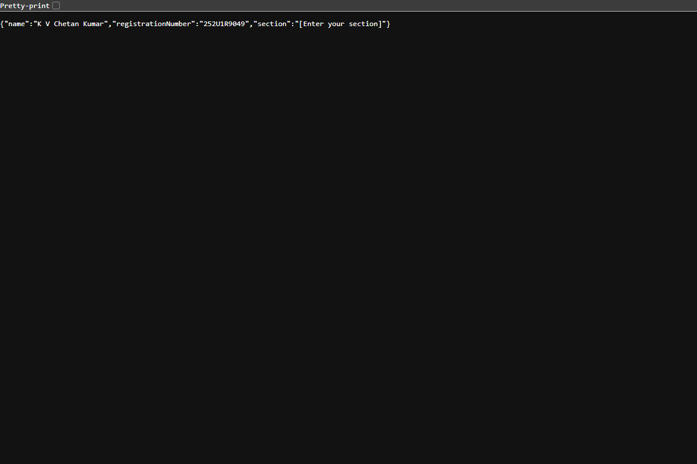
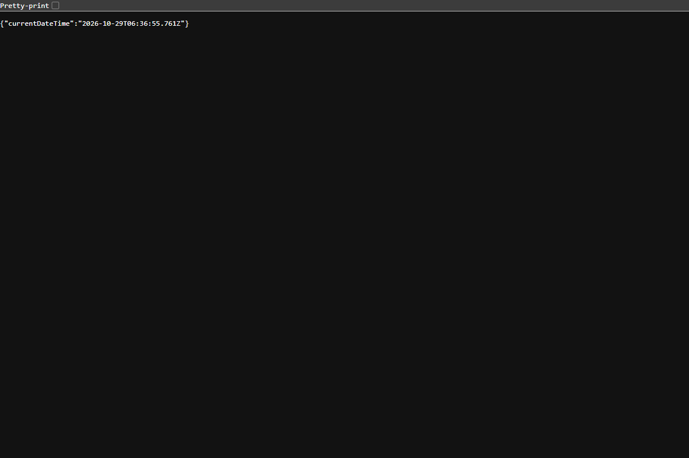
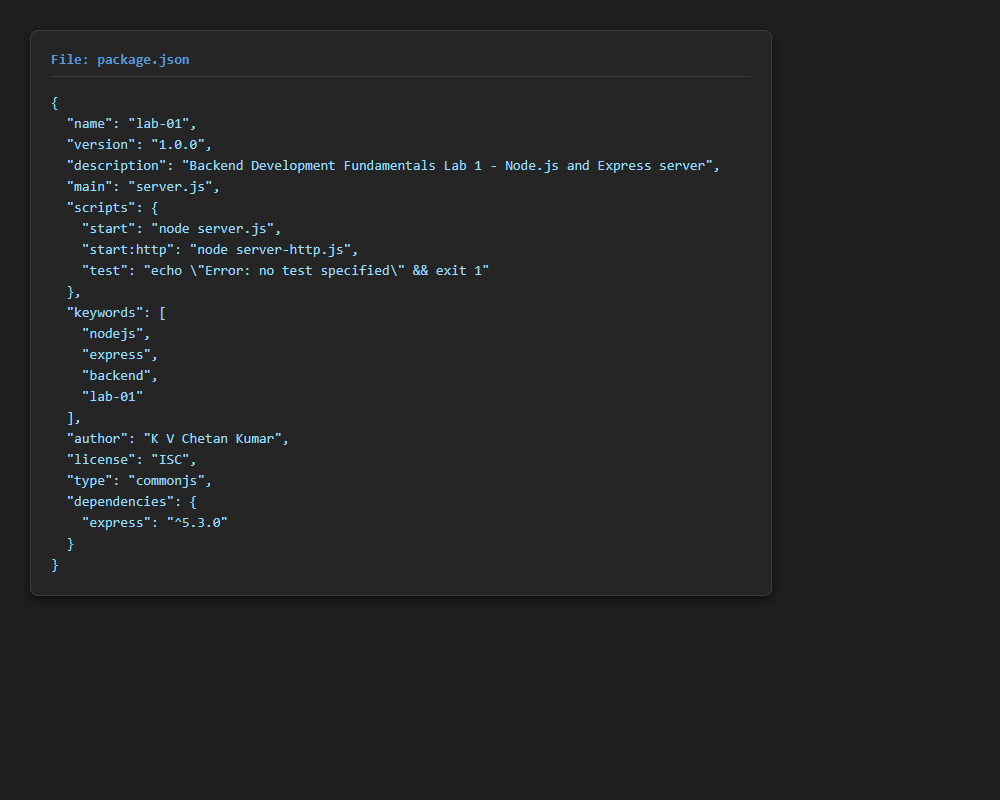

# Lab 1: Node.js and Express Server

## Student Details

- **Name:** K V Chetan Kumar
- **Registration / Roll Number:** 252U1R9049
- **Course:** Backend Development Fundamentals
- **Lab Number:** 01
- **Lab Title:** Node.js and Express server
- **Section:** [Enter your section]

---

## Live Deployment Status

- **Status:** Not Deployed (Executed and verified in local environment)
- **Deployment Limitation:** Cloud deployment requires connecting to an external cloud platform account (e.g., Vercel or Render). Step-by-step instructions for deploying to cloud platforms are provided in the [Deployment Guide](#deployment-guide) section below.

---

## Objective

1. Initialize a Node.js project using `npm init -y` and understand the structure and purpose of `package.json`.
2. Install external dependencies using `npm install express` and verify their registration in `package.json`.
3. Create a basic HTTP server using Node.js's built-in `http` module (`server-http.js`).
4. Build an Express.js server (`server.js`) implementing:
   - Root GET route (`/`) returning a welcome message with HTTP 200.
   - About GET route (`/about`) returning student details in JSON format with HTTP 200.
   - Time GET route (`/time`) returning the current date and time with HTTP 200.
   - Catch-all 404 handler for undefined routes returning HTTP 404.
5. Capture authentic screenshots of the running server and responses.
6. Configure `.gitignore` to prevent committing `node_modules/` or sensitive files.

---

## Technologies Used

- **Runtime:** Node.js (v24.x)
- **Framework:** Express.js (v5.x)
- **Language:** JavaScript (CommonJS)
- **Package Manager:** npm (v11.x)
- **Testing & Verification:** Google Chrome & PowerShell HTTP Client

---

## Project Structure

```text
lab-01/
├── screenshots/
│   ├── home.png
│   ├── about.png
│   ├── time.png
│   ├── not-found.png
│   ├── http-server.png
│   └── package-json.png
├── server-http.js
├── server.js
├── package.json
├── package-lock.json
├── .gitignore
└── README.md
```

---

## Explanation of `package.json` Fields

When `npm init -y` is run, it generates a manifest file called `package.json`. Here is an explanation of every field:

| Field | Value in Project | Explanation |
|---|---|---|
| `name` | `"lab-01"` | The name of the project or package. It must be lowercase, URL-friendly, and unique if published to npm. |
| `version` | `"1.0.0"` | The current version of the project following Semantic Versioning (`MAJOR.MINOR.PATCH`). |
| `description` | `"Backend Development Fundamentals..."` | A short summary explaining what the project or package is about. |
| `main` | `"server.js"` | The primary entry point file of the application that gets executed when the package is required or imported. |
| `scripts` | `{"start": "...", "start:http": "...", "test": "..."}` | A dictionary of terminal commands and aliases that can be run with `npm run <script-name>` or `npm start`. |
| `keywords` | `["nodejs", "express", ...]` | An array of tags/keywords used to index and discover the package on package repositories. |
| `author` | `"K V Chetan Kumar"` | The name and optional contact info of the person who created or maintains the project. |
| `license` | `"ISC"` | The legal software license specifying terms under which others can use, modify, or distribute the code. |
| `type` | `"commonjs"` | The module system used by Node.js. `"commonjs"` uses `require()` and `module.exports`, whereas `"module"` enables ES Module `import`/`export`. |
| `dependencies` | `{"express": "^5.3.0"}` | A list of external npm packages required for the application to function in production, along with their semantic version range (`^` allows compatible minor/patch updates). |

---

## Installation and Setup

### Prerequisites

- [Node.js](https://nodejs.org/) installed (includes `npm`).
- A code editor like [Visual Studio Code](https://code.visualstudio.com/).

### Installation Steps

1. Open your terminal and navigate to the `lab-01` directory:
   ```bash
   cd lab-01
   ```

2. Install all required project dependencies:
   ```bash
   npm install
   ```

### Running the Express Server

To start the main Express server:

```bash
npm start
```
*(Alternatively: `node server.js`)*

The server will start listening at:
`http://localhost:3000`

### Running the Built-in HTTP Server

To start the simple server built using Node's core `http` module:

```bash
npm run start:http
```
*(Alternatively: `node server-http.js`)*

> **Note:** Only one server can use port 3000 at a time. Press `Ctrl + C` to stop a running server before starting the other.

---

## API Endpoints

| HTTP Method | Route / Endpoint | Description | Response Type | Expected Status Code |
|---|---|---|---|---|
| **GET** | `/` | Welcome message | Plain text | `200 OK` |
| **GET** | `/about` | Student name, registration number, and section | JSON | `200 OK` |
| **GET** | `/time` | Current date and timestamp using `new Date()` | JSON | `200 OK` |
| **GET** | `/unknown` *(any undefined path)* | Catch-all handler for invalid URLs | Plain text | `404 Not Found` |

---

## Verified Screenshots

All screenshots below are authentic captures from the running application.

### 1. Home Route (`GET /`)
Displays the server welcome message with HTTP 200 OK.


### 2. About Route (`GET /about`)
Displays the student's name, registration number, and section placeholder in JSON format with HTTP 200 OK.



### 3. Time Route (`GET /time`)
Displays the server's current date and time generated via `new Date()` in JSON format with HTTP 200 OK.



### 4. Unknown Route (`GET /unknown`)
Demonstrates the 404 Page Not Found catch-all handler with HTTP status 404.


### 5. Built-in HTTP Module Server (`server-http.js`)
Demonstrates the plain Node.js `http.createServer` responding with "Hello" on port 3000.


### 6. Project Configuration (`package.json`)
Displays the complete `package.json` file with metadata, scripts, and dependencies.



---

## Viva Questions & Answers

### 1. What is the difference between `package.json` and `node_modules`?
- **`package.json`**: A lightweight project configuration file that records metadata, scripts, and a list of dependencies with their version ranges. It is committed to version control so anyone can recreate the project.
- **`node_modules`**: The directory that stores the actual downloaded JavaScript code and binary files for all dependencies and their sub-dependencies. It is large and can be regenerated anytime by running `npm install`, so it should **never** be committed to Git.

### 2. What does `app.listen()` do?
`app.listen()` binds the Express application to a specified TCP port (e.g., port 3000) and begins listening for incoming HTTP connections and requests from clients (browsers, API clients).

### 3. What do `request` and `response` represent?
- **`request` (`req`)**: An object representing the incoming HTTP request sent by the client. It contains details such as HTTP method, headers, query parameters, route parameters, and request body.
- **`response` (`res`)**: An object representing the outgoing HTTP response sent back to the client. It provides methods like `.status()`, `.send()`, and `.json()` to set HTTP status codes, headers, and payload data.

---

## Problems Faced and Solutions

1. **Port Collision (`EADDRINUSE: port 3000 already in use`):**
   - *Problem:* Attempting to run `server.js` while `server-http.js` was still active caused an error because both servers are configured to listen on port 3000.
   - *Solution:* Stop the currently active server by pressing `Ctrl + C` in the terminal before starting the next server, or configure a port fallback via `process.env.PORT || 3000`.

2. **Git Executable Missing from System PATH:**
   - *Problem:* The `git` command was not recognized in the system terminal environment.
   - *Solution:* Detailed manual Git steps were documented so the user can easily install Git or use VS Code's built-in Source Control tab to commit and push the project.

---

## Deployment Guide

If you wish to deploy this project live to the web, you can use **Render** or **Vercel**:

### Option A: Deploying on Render (Recommended for Express)
1. Push your repository to your GitHub account.
2. Sign up / Log in to [Render](https://render.com/).
3. Click **New +** > **Web Service**.
4. Connect your GitHub repository and select the `lab-01` directory as the Root Directory.
5. Set:
   - **Build Command:** `npm install`
   - **Start Command:** `node server.js`
6. Click **Deploy Web Service**. Render will generate a live public URL.

### Option B: Deploying on Vercel
1. Install Vercel CLI: `npm install -g vercel`
2. Add a `vercel.json` file inside `lab-01/`:
   ```json
   {
     "version": 2,
     "builds": [
       { "src": "server.js", "use": "@vercel/node" }
     ],
     "routes": [
       { "src": "/(.*)", "dest": "server.js" }
     ]
   }
   ```
3. Run `vercel` in terminal and follow the setup prompts.

---

## Git & Submission Instructions

### Files Excluded from Version Control
The `.gitignore` file contains rules to exclude:
- `node_modules/` (installed package binaries)
- `.env` and `.env.local` (environment variables and secrets)
- OS and debug log files

### Commands to Commit and Push

Once Git is installed on your system, execute the following commands in the project folder:

```bash
# 1. Initialize git (if not already a git repository)
git init

# 2. Add all lab-01 files (node_modules is automatically ignored)
git add lab-01/

# 3. Create a commit
git commit -m "Complete Lab 1: Node.js and Express server with verified screenshots"

# 4. Set default branch to main
git branch -M main

# 5. Link your personal GitHub repository (replace with your repository URL)
git remote add origin https://github.com/<YOUR_USERNAME>/<YOUR_REPOSITORY>.git

# 6. Push code to your GitHub repository
git push -u origin main
```
