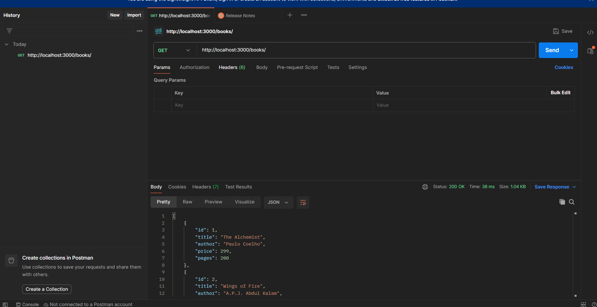
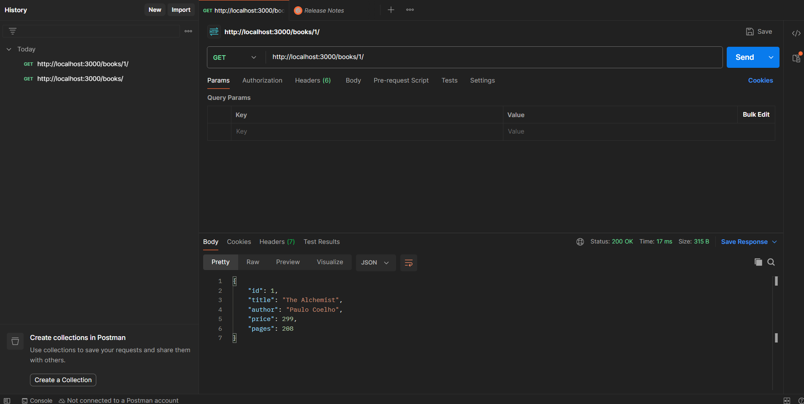
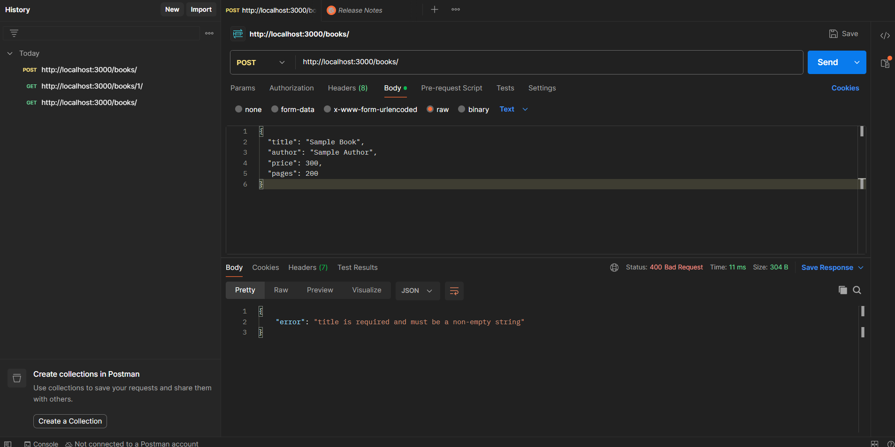
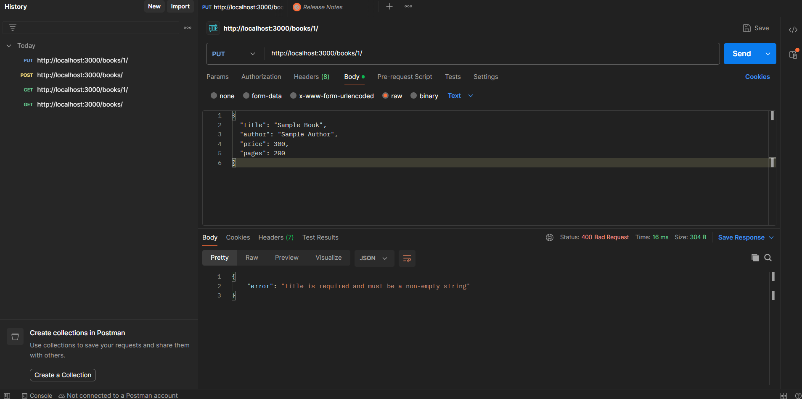
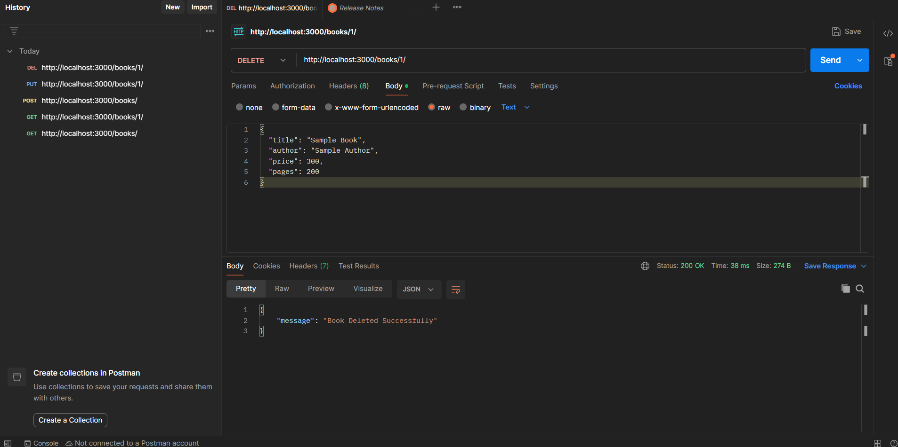
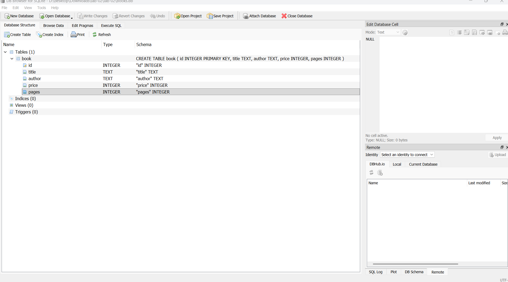

# Lab 2: SQLite database and CRUD routes

- **Name:** K V Chetan Kumar
- **Registration Number:** 252U1R9049
- **Section:** CSE GEN AI 2A
- **Course:** Backend Development Fundamentals
- **Lab Number:** 02

## Live Deployment (Render)

- **Status:** 🟢 Live and Deployed on Render
- **Deployment URL:** [https://backend-development-fundamentals-2-byeq.onrender.com/](https://backend-development-fundamentals-2-byeq.onrender.com/)

### Live Endpoints
- **Root API Status (`GET /`):** [https://backend-development-fundamentals-2-byeq.onrender.com/](https://backend-development-fundamentals-2-byeq.onrender.com/)
- **Get All Books (`GET /books/`):** [https://backend-development-fundamentals-2-byeq.onrender.com/books/](https://backend-development-fundamentals-2-byeq.onrender.com/books/)
- **Get One Book (`GET /books/1/`):** [https://backend-development-fundamentals-2-byeq.onrender.com/books/1/](https://backend-development-fundamentals-2-byeq.onrender.com/books/1/)

## Objective

Connect an Express server to a SQLite database and expose CRUD operations (Create, Read, Update, Delete) over HTTP.

## Technologies Used

Node.js, Express.js, SQLite (`sqlite` + `sqlite3` packages), nodemon, Postman, Visual Studio Code

## Project Structure

```
lab-02/
├── screenshots/
├── app.js            # Express server + SQLite + all routes
├── books.db          # SQLite database file (table: book, 10 rows)
├── seed.sql          # SQL used to create the table and insert the rows
├── package.json
├── package-lock.json
├── .env.example
├── .gitignore
└── README.md
```

## How to Run

**Prerequisites:** Node.js and npm installed. (Optional: the SQLite CLI, to inspect `books.db`.)

```
cd lab-02
npm install
npm run dev      # development: nodemon restarts the server on every change
npm start        # plain start: node app.js
```

The server runs at `http://localhost:3000/`.

**Environment variables:** none are required. `PORT` is optional (default `3000`); see `.env.example`. Never commit a real `.env` file.

### Deployment on Render

1. In the [Render Dashboard](https://dashboard.render.com), create a new **Web Service** or select your existing one.
2. Under **Settings**:
   - **Root Directory:** `lab-02`
   - **Build Command:** `npm install && npm rebuild sqlite3 --build-from-source`
   - **Start Command:** `node app.js` (or `npm start`)
   *(Note: The `--build-from-source` step is also automatically triggered on Linux via `postinstall` to resolve GLIBC compatibility).*

### Create the database again (optional)

`books.db` is already included. To rebuild it from scratch with the SQLite CLI:

```
sqlite3 books.db < seed.sql
```

To inspect the data:

```
sqlite3 books.db
.headers on
.mode column
SELECT * FROM book;
```

## Endpoints

| Method | Path              | Description                  | Success status | Error statuses |
| ------ | ----------------- | ---------------------------- | -------------- | -------------- |
| GET    | `/books/`         | Returns all books            | 200 OK         | 500            |
| GET    | `/books/:bookId/` | Returns one book by id       | 200 OK         | 400, 404, 500  |
| POST   | `/books/`         | Adds a new book (JSON body)  | 201 Created    | 400, 500       |
| PUT    | `/books/:bookId/` | Updates all fields of a book | 200 OK         | 400, 404, 500  |
| DELETE | `/books/:bookId/` | Deletes a book               | 200 OK         | 400, 404, 500  |

**Request body for POST and PUT:**

```json
{
  "title": "Sample Book",
  "author": "Sample Author",
  "price": 300,
  "pages": 200
}
```

- `400 Bad Request`: invalid id, missing or invalid fields, or invalid JSON.
- `404 Not Found`: no book with that id, or an unknown route.
- Every query that uses user input is parameterised with `?` placeholders.

## Screenshots

Postman screenshots of the endpoints, plus the database view.

### GET all books (200)



### GET one book (200)



### POST invalid input (400)



<!-- Add after re-testing with Body > raw > JSON:
### POST add a book (201)


-->

### PUT invalid input (400)



<!-- Add after re-testing with Body > raw > JSON:
### PUT update a book (200)


-->

### DELETE remove a book (200)



### SQLite database (DB Browser for SQLite)



## Viva Questions

### 1. Why `await` the database call?

Database calls take time and return a Promise. `await` pauses that function until the result is ready, so we use real data and not an unfinished Promise. It also lets us wait for the connection to open before the server starts.

### 2. What is SQL injection and how do placeholders prevent it?

SQL injection is when an attacker puts SQL code into an input, such as `1 OR 1=1`, and it becomes part of the query. With `?` placeholders, the SQL text and the values are sent separately, so the input is always treated as data and never as SQL code.

### 3. When is PUT used instead of POST?

POST creates a new resource (the server picks the id). PUT replaces or updates an existing resource at a known URL, such as `/books/3/`.

## Notes: Problems Faced and Solutions

1. **Linux GLIBC Incompatibility on Render (`version 'GLIBC_2.38' not found`):**
   - *Problem:* Deploying to Render caused a fatal crash at startup:
     ```text
     Error: /lib/x86_64-linux-gnu/libm.so.6: version 'GLIBC_2.38' not found (required by node_sqlite3.node)
     ```
     The precompiled `sqlite3` binary downloaded from npm was compiled against GLIBC 2.38, whereas Render's Ubuntu container runs GLIBC 2.35.
   - *Solution:* Added a `postinstall.js` script to automatically trigger `npm rebuild sqlite3 --build-from-source` when running in a Linux environment. This forces `node-gyp` to compile the binary natively against Render's system GLIBC, ensuring seamless compatibility while leaving local Windows builds untouched.

2. **Ephemeral Storage on Render Free Tier:**
   - *Problem:* Any changes made to the database (`books.db`) via live `POST`, `PUT`, or `DELETE` requests would reset back to the committed seed state whenever Render spun down due to inactivity or restarted.
   - *Solution:* Documented the behavior of file-based SQLite databases in containerized ephemeral hosting. For cloud persistence, a Render Persistent Disk or hosted database (such as PostgreSQL) should be mounted; for evaluation and grading, changes persist reliably in the local development environment and verified Postman screenshots are provided.

3. **Input Validation and Malformed JSON (HTTP 400 Handling):**
   - *Problem:* Sending invalid data types (e.g. non-numeric strings for `price` or `pages`) or broken JSON caused SQL errors or crashed the request flow with HTTP 500 instead of returning helpful client errors.
   - *Solution:* Created modular validation functions (`isValidId` and `validateBook`) to strictly validate types and non-empty strings before reaching the database query, and added an Express JSON parsing error middleware (`err.type === 'entity.parse.failed'`) to catch bad JSON bodies and return clear HTTP 400 responses.

4. **Port Binding for Production vs. Local Development:**
   - *Problem:* Hardcoding `app.listen(3000)` would cause deployment to fail on Render because cloud platforms assign a random dynamic port through environment variables.
   - *Solution:* Implemented dynamic port assignment: `const PORT = process.env.PORT || 3000;`, enabling automatic port binding in cloud environments while defaulting to `3000` during local development.
